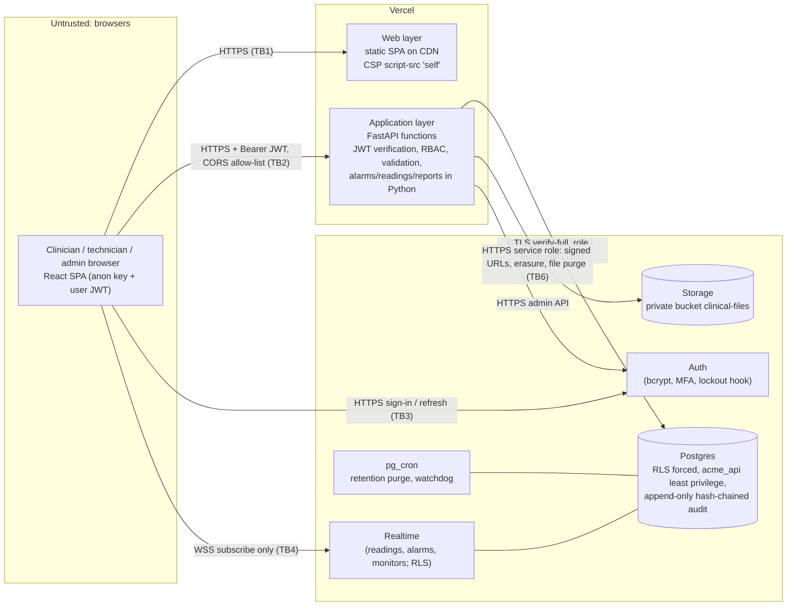

# Secure cloud architecture

Three layers, deployed separately (T2288/T2300/T2361):

| Layer | Deployment | Holds | Talks to | Never holds |
|---|---|---|---|---|
| **Web (presentation)** | `frontend/` static build on the Vercel CDN (TLS, DDoS protection, multi-region edge) | Supabase **anon** key, the user's session tokens | API (HTTPS), Supabase Auth (HTTPS), Supabase Realtime (WSS, read-only, RLS) | service role key, JWT secret, DB credentials |
| **Application** | `backend/` FastAPI on Vercel Python Functions (autoscaled, load-balanced) | `SUPABASE_SERVICE_ROLE_KEY`, `SUPABASE_JWT_SECRET`, `DATABASE_URL` of the `acme_api` role (Vercel *Sensitive* env vars) | Postgres (TLS `verify-full`), Supabase Admin/Storage API (HTTPS) | the Postgres superuser password |
| **Data** | Supabase: Postgres (RLS forced on every table), Auth, private Storage bucket, Realtime | data, password hashes | - | - |

## Trust boundaries and controls

| Boundary | Controls |
|---|---|
| TB1 browser -> CDN | HTTPS only (HSTS), CSP `script-src 'self'` and same-origin chunks, no secrets in the bundle (CI grep) |
| TB2 browser -> API | Supabase JWT verified on every request (signature, `aud`, `iss`, expiry), role and activation read from the database on every request, deny-by-default route inventory (startup fails in production if a route is unprotected), CORS exact-origin allow-list, rate limits (429), body-size limits, strict JSON schemas, generic errors, security headers, `Cache-Control: no-store` |
| TB3 browser -> Supabase Auth | e-mail/password with lockout hook, MFA for administrators, password policy |
| TB4 browser -> Realtime | read-only grants on `readings`/`alarms`/`monitors` columns; RLS `can_access_patient()` filters every row a session receives; the browser cannot write any table (no INSERT/UPDATE/DELETE grants to `authenticated`) |
| TB5 API -> Postgres | dedicated login role `acme_api` without DDL, superuser or BYPASSRLS; per-transaction `app.user_id`/`app.role` drive RLS; column-level grants; bulk deletes only through SECURITY DEFINER functions owned by `acme_reset_owner` |
| TB6 API -> Storage/Admin API | service role key confined to the backend; fixed base URL (no user-supplied URLs, SSRF tests); verified TLS |

All writes (observations, acknowledgements, thresholds, devices, simulation, settings, staff) go through the API. The
SPA reads reference data (`beds`) and subscribes to Realtime directly, always under RLS.

## Availability and redundancy

* Static assets are served from Vercel's global CDN; functions scale automatically.
* **Region alignment:** deploy the API functions in the same region as the Supabase project (set the Vercel project's
  *Function Region*, e.g. `iad1` for `us-east-1`, or `"regions": ["iad1"]` in `backend/vercel.json`).
* Supabase daily backups, optional PITR (recommended for real data), and a read replica for reports if load grows.
* Vercel Firewall / Attack Challenge Mode can be enabled for abusive traffic; API rate limits apply per client.
* Recovery steps: [deployment.md](deployment.md) and the README runbook.

## Verification checklist (T2300) — record date and result for each environment

| Check | How |
|---|---|
| Three separate deployments match this document | Vercel dashboard: two projects (`frontend`, `backend`) + one Supabase project |
| Browser key cannot write protected tables | `test_database_policies.py` (no write grants to `authenticated`); live: `supabase.from('alarms').insert(...)` with a staff session must fail |
| Service role key absent from the frontend bundle | CI step "bundle has no server secrets" |
| Function region equals Supabase region | Vercel project settings vs Supabase project settings |
| CDN, autoscaling, backups/PITR enabled | Vercel and Supabase dashboards |
